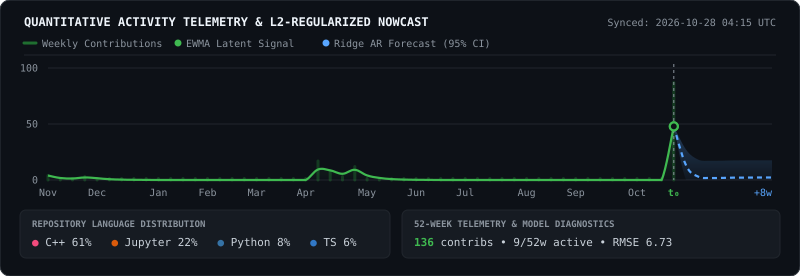

# Mark Kevin A. Ong Yiu 

I am an AI & Data Science Manager and solo technical leader specializing in end-to-end system architecture. I bridge rigorous applied mathematics with production-grade full-stack engineering to build autonomous data pipelines, machine learning demand-forecasting models, and enterprise applications from the ground up.

### 🛠️ Core Engineering Stack

**Languages & Data Infrastructure**

  
  
  
  
  

**Machine Learning & Scientific Computing**

  
  
  

**Full-Stack & Business Intelligence**

  
  
  
  

### 🏗️ Production Systems Architected
*   **Autonomous Global Freight & Container Telemetry Platform:** Architected an end-to-end data pipeline and web application for an international manufacturing enterprise to replace fragmented, manual spreadsheet tracking across cross-border ocean freight corridors.
    

    
<b>View Architecture & Operational Impact</b>

     
    <ul>
      <li><b>Automated Multi-Source Ingestion:</b> Eliminated manual copy-pasting across siloed local spreadsheets by building direct data connectors to enterprise ERP systems and external ocean carrier APIs.</li>
      <li><b>Data Integrity & Validation Guardrails:</b> Engineered automated schema validation, anomaly detection, and state-transition checks at ingestion to prevent downstream data corruption.</li>
      <li><b>Zero-Touch Reporting Engine:</b> Automated the generation of operational and executive logistics reports—compressing workflows that previously required a full employee workday of manual reconciliation into instantaneous outputs.</li>
    </ul>
    

### 🚀 Quantitative Research & Analytics
*   **Macroeconomic Nowcasting:** Quantitative research implementing L1 and L2 regularization on Dynamic Factor Models (DFM) for GDP forecasting, developed during my Mathematical Informatics research at NAIST.
*   **[Undernutrition Classification ML](https://doi.org/10.1063/5.0213404):**  Applied XGBoost, Neural Networks, and Oversampling techniques for classification, presented at the ICOAIMS 2023 conference.

### 📈 Live Contribution Telemetry & Nowcast

  

📫 [Website](https://www.ongyiumark.com) • [LinkedIn](https://www.linkedin.com/in/ongyiumark/)
